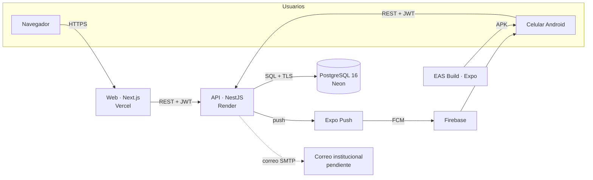

# ReservaITN

Sistema de reservas de salas y laboratorios para el **Instituto Técnico del Norte (ITN), Arica**.
Proyecto P05 de **JBG Tech**: Benjamín Naveas (director y frontend), José Labarca (full stack),
Gonzalo Pino (ingeniero de sistemas) y Braulio Campos (QA y diseño de la web).

> **Estado al 18/11/2026 · incremento 2:** los 10 módulos de desarrollo (EDT 1.4) funcionan y el sistema
> está publicado en la nube, separado en servicios independientes. Web, API, base de datos y app Android
> se pueden probar desde cualquier lugar. Plazo del proyecto: 07/10 → 17/12/2026.

## Pruébalo ahora

| Qué | Dónde |
|---|---|
| **Web** (administración, dashboard, reservas) | **https://reserva-itn-puce.vercel.app** |
| **API** (estado) | https://reservaitn.onrender.com/api/health |
| **App Android** (APK de prueba) | Último build en [expo.dev · jgb-team/reservaitn](https://expo.dev/accounts/jgb-team/projects/reservaitn/builds) |

Todas las cuentas de demostración usan la contraseña **`reservaitn`** (datos ficticios):

| Cuenta `@itn.cl` | Rol | Para probar |
|---|---|---|
| `subdireccion` | Subdirección | **Control total**: ve y recibe aviso de todas las solicitudes, aprueba y cancela cualquiera (con motivo) |
| `dir.inf` | Director de Informática + docente | Aprueba lo de Informática y el LAB-INF1 |
| `dir.enf` | Directora de Enfermería | No ve lo de Informática |
| `docente` | Docente de Informática | Reserva desde la web o la app; sus solicitudes van al director |
| `estudiante` | Estudiante de Informática | Reserva salas de estudio con autorización |
| `academica`, `datd`, `operaciones`, `aseo` | Un rol cada uno | Dashboard, importación, mantención, daños e inventario |

> **Primera visita del día:** la API usa el plan gratis de Render y se duerme tras 15 minutos sin uso.
> El login muestra "Conectando con el servidor…" y tarda cerca de un minuto en despertarla.

## Arquitectura: un servicio por responsabilidad



| Servicio | Proveedor (plan) | Qué hace | Configuración |
|---|---|---|---|
| **Web** | Vercel (Hobby, gratis) | Pantallas para administrar, aprobar, ver el dashboard y reservar. No guarda datos: todo lo pide a la API | `apps/web/vercel.json`, variables `NEXT_PUBLIC_*` |
| **API** | Render (Free) | Reglas de negocio, permisos, validaciones, reportes Excel. Al iniciar aplica las migraciones pendientes. Corre tareas cada 15 s (cola de avisos) y cada minuto (vencer pendientes y liberar reservas sin check-in) | `render.yaml` |
| **Base de datos** | Neon (Free) | PostgreSQL 16 gestionado. Las reglas críticas viven aquí: anti-choques (`EXCLUDE`), transiciones de estado, auditoría inmutable, aprobadores por regla | `packages/db/migraciones` (V001–V013) |
| **App móvil** | Expo EAS Build (gratis) | Compila el APK de Android en la nube. Reservar, mis reservas, check-in por QR, avisos, inventario y daños | `apps/mobile/eas.json`, proyecto `@jgb-team/reservaitn` |
| **Push** | Expo Push + Firebase (gratis) | Lleva las notificaciones al celular registrado | `apps/mobile/google-services.json` + clave FCM en Expo |
| **Correo** | SMTP del ITN | Avisos por correo con reintentos. **En la nube queda en cola hasta configurar `SMTP_URL`** | Variable en Render |

### Cómo viaja una solicitud

1. Un docente pide una sala desde la **app** o la **web**. La API valida los datos con los mismos
   esquemas Zod que usa la interfaz (`packages/shared`).
2. La **base de datos** rechaza cualquier choque de horario, incluso entre solicitudes simultáneas, y
   registra quién hizo cada cambio.
3. Según la regla aplicable, se aprueba sola o queda **pendiente**. El aviso llega a quien debe aprobar
   y, siempre, a **Subdirección** (supervisión total, migración V013).
4. Cada aviso queda en la **bandeja de la app y de la web**, y entra a una **cola de envío** (correo y push)
   con reintentos crecientes: si un servicio externo falla, la reserva no se pierde.
5. Al aprobar, rechazar o cancelar (con motivo), el solicitante recibe el aviso en su celular.

## Lo más importante

- **Cero reservas dobles (R1):** lo garantiza la base de datos con una restricción `EXCLUDE`. Probado con
  200 casos aleatorios y 20 solicitudes simultáneas por el mismo horario: exactamente una queda.
- **Reglas configurables sin programar:** roles, permisos y quién aprueba qué viven en tablas.
  Subdirección tiene control total por permiso (`reserva:aprobar_cualquiera`), no por código.
- **Trazabilidad completa (R7):** cada reserva muestra quién la pidió, quién la aprobó o canceló, cuándo
  y con qué motivo. La bitácora de auditoría no se puede modificar ni borrar.
- **Una regla, tres clientes:** web, app y API comparten validaciones y roles (`packages/shared`).
- **Reportes profesionales:** dashboard con ocupación, indicadores, mapa por jornada y Excel de 4 hojas.
- **Datos de prueba realistas:** ~880 reservas (clases importadas, solicitudes, pendientes y canceladas)
  que se cargan solas una única vez en una base nueva (`D002`).
- **108 pruebas automáticas** en CI: reglas compartidas, restricciones de la base, flujos completos de la API.

## Estado de los módulos (EDT 1.4)

| EDT | Módulo | Estado |
|---|---|---|
| 1.4.1 | Usuarios, roles y acceso | ✅ |
| 1.4.2 | Salas, laboratorios, sedes e inventario (con QR) | ✅ |
| 1.4.3 | Importación de planificación | 🟡 ajustar al Excel real del ITN |
| 1.4.4 | Reservas, aprobaciones, cancelación con motivo, anti-choques | ✅ |
| 1.4.5 | Sugerencia de sala y alternativas | ✅ |
| 1.4.6 | Notificaciones y liberación sin check-in | 🟡 app, web y push ✅ · correo en la nube pendiente de SMTP |
| 1.4.7 | Dashboard, trazabilidad y reportes Excel | ✅ |
| 1.4.8 | Proyección de uso por día y jornada | ✅ |
| 1.4.9 | App de docentes y estudiantes | ✅ Android · iPhone requiere cuenta Apple del ITN |
| 1.4.10 | App de mantención y aseo | ✅ Android · ídem |

Detalle por requisito R1–R19: [docs/06-trazabilidad.md](docs/06-trazabilidad.md).

## Estructura del repositorio

```
reservaitn/
├── apps/
│   ├── api/            API REST (NestJS + Prisma). Un módulo por paquete de la EDT 1.4
│   │   ├── src/        usuarios · recursos · importacion · reservas · sugerencia · notificaciones
│   │   │               dashboard · proyeccion · mantencion · tareas · comun
│   │   └── test/       pruebas de integración contra PostgreSQL
│   ├── web/            Next.js 16: app/(panel)/<pantalla>, components/ (Panel, ui), lib/ (api, formato)
│   └── mobile/         Expo SDK 58: src/docentes, src/mantencion, src/comun · eas.json
├── packages/
│   ├── db/             SQL fuente de verdad: migraciones V001–V013, semillas, pruebas de restricciones
│   └── shared/         roles y permisos, esquemas Zod, reglas (choques, sugerencia, ocupación)
├── docs/               guía de inicio, arquitectura, modelo de datos, pruebas, despliegue, web, ADR
├── infra/              docker-compose para desarrollo (PostgreSQL + Mailpit)
├── render.yaml         blueprint de la API en Render
└── .github/            CI y plantillas de issues y PR
```

## Desarrollo local

Guía completa paso a paso (incluye la app en el celular y problemas frecuentes):
**[docs/00-guia-de-inicio.md](docs/00-guia-de-inicio.md)**. Resumen (Node 22, pnpm 10, Docker):

```bash
pnpm install
```

```bash
pnpm db:up
```

```bash
cp apps/api/.env.example apps/api/.env && cp apps/web/.env.example apps/web/.env.local
```

```bash
pnpm db:seed
```

```bash
pnpm dev
```

Web en http://localhost:3000 · API en http://localhost:3001/api/health · correos de prueba en
http://localhost:8025. App móvil: `pnpm dev:movil` (configurar `apps/mobile/.env`; por defecto apunta a la nube).

| Comando | Qué hace |
|---|---|
| `pnpm dev` / `pnpm dev:movil` | Levanta API y web / Metro de Expo |
| `pnpm test` | Pruebas unitarias (reglas y validaciones) |
| `pnpm --filter @reservaitn/db test:db` | 42 pruebas de restricciones del modelo de datos |
| `pnpm --filter @reservaitn/api test:db` | 29 pruebas de integración (flujos, concurrencia, correos, push, reportes) |
| `pnpm typecheck` / `pnpm build` | Tipos y compilación de todo el monorepo |
| `npx eas-cli build -p android --profile preview` | APK de prueba (desde `apps/mobile`) |

## Cómo se publica

| Servicio | Se actualiza | Detalle |
|---|---|---|
| Web (Vercel) | Solo, con cada push a `feat/api-modelo-v1` | Rama de producción configurada en Vercel |
| API (Render) | Solo, con cada push a la misma rama | Aplica migraciones nuevas al iniciar |
| Base (Neon) | Con la API | Migraciones versionadas con checksum: nunca se edita una ya aplicada |
| App (EAS) | A pedido | `eas build`; el APK se instala por enlace o QR |

Guía de despliegue, costos de producción y variables de entorno: [docs/08-despliegue.md](docs/08-despliegue.md).

## Recomendaciones profesionales

**Antes de la puesta en marcha (H7, 11/12)**

1. **Producción separada de la demostración.** Base nueva sin datos demo (`MIGRAR_OPCIONES=--semillas`),
   `JWT_SECRET` propio, `NEXT_PUBLIC_MOSTRAR_DEMO` sin definir y cuentas a nombre del ITN.
2. **API y base en la misma región.** Hoy la API está en Oregón y la base en São Paulo: cada solicitud
   tarda unos 9 s. En la misma región baja a 1–2 s.
3. **Plan pagado para la API** (sin "dormirse") y respaldos con recuperación a un punto en el tiempo,
   como está presupuestado en `docs/08-despliegue.md`.
4. **Correo institucional** (`no-responder@itn.cl`) con SPF/DKIM para que los avisos no lleguen a spam.
5. **Dominio propio** (`reservas.itn.cl`) con HTTPS para la web y la API.

**Calidad y seguridad**

6. **Proteger `main`:** todo cambio por pull request con CI en verde y revisión de otro integrante.
7. **Pruebas de extremo a extremo** de la web (Playwright) en el CI, además de las de integración.
8. **Rotar secretos** al pasar a producción y borrar los tokens usados en el desarrollo (Vercel, Render,
   Neon, Expo). Nunca subir claves al repositorio.
9. **Límite de intentos en el login** y registro de accesos fallidos (Ley 19.628 de datos personales).
10. **Monitoreo:** alerta si `/api/health` cae y registro de errores (por ejemplo Sentry).

**Producto**

11. **Excel real del ITN** para cerrar R9, y validar con el cliente los campos de una reserva (R19).
12. **iPhone y tiendas:** obtener el número D-U-N-S y las cuentas Apple/Google a nombre del ITN.
13. **Actualizaciones sin reinstalar** (EAS Update) para corregir la app sin un APK nuevo.
14. **Capacitación** con los usuarios clave antes de la UAT y manuales de usuario web y móvil.

## Documentación

0. [Guía de inicio](docs/00-guia-de-inicio.md)
1. [Metodología de trabajo](docs/01-metodologia.md)
2. [Roadmap por sprint](docs/02-roadmap.md)
3. [Arquitectura y endpoints](docs/03-arquitectura.md)
4. [Modelo de datos](docs/04-modelo-datos.md): [decisiones](docs/modelo-datos/decisiones.md) y [normalización](docs/modelo-datos/normalizacion.md)
5. [Flujo Git y GitHub](docs/05-flujo-git.md)
6. [Matriz de trazabilidad R1–R19](docs/06-trazabilidad.md)
7. [Estrategia de pruebas](docs/07-pruebas.md)
8. [Despliegue, nube y costos](docs/08-despliegue.md)
9. [Web: pantallas y diseño](docs/09-web.md)
10. [Decisiones de arquitectura (ADR)](docs/adr/)

Registro de cambios: [CHANGELOG.md](CHANGELOG.md).
